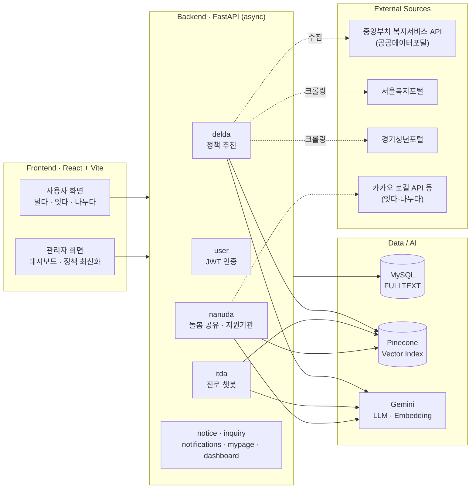
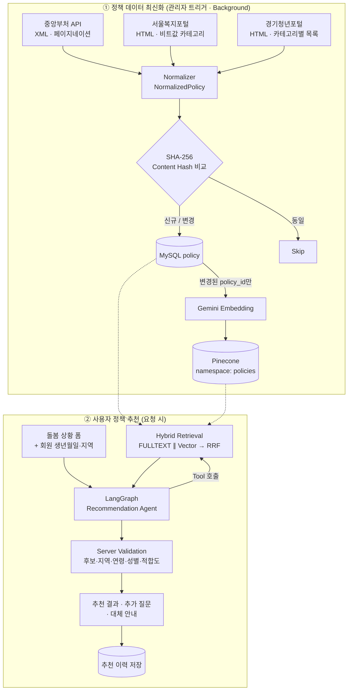
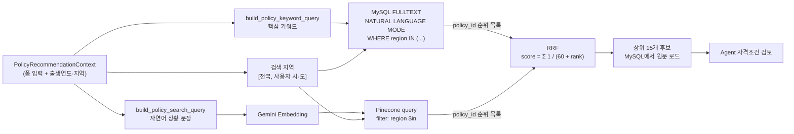
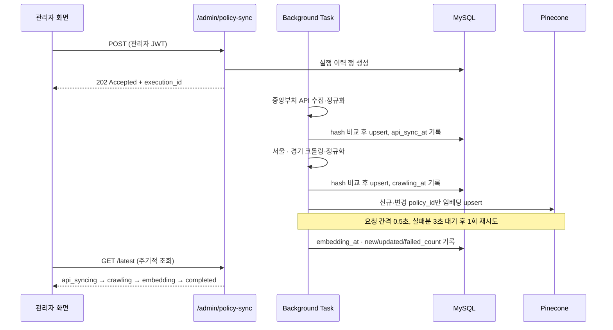
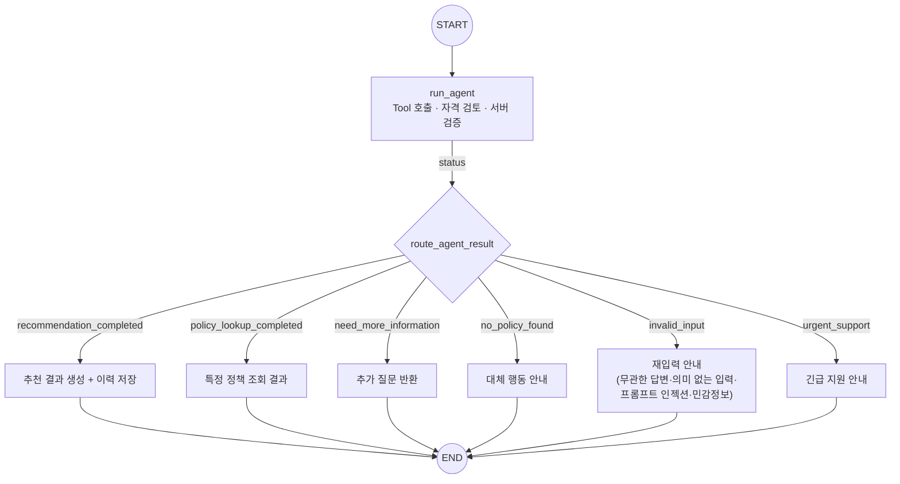
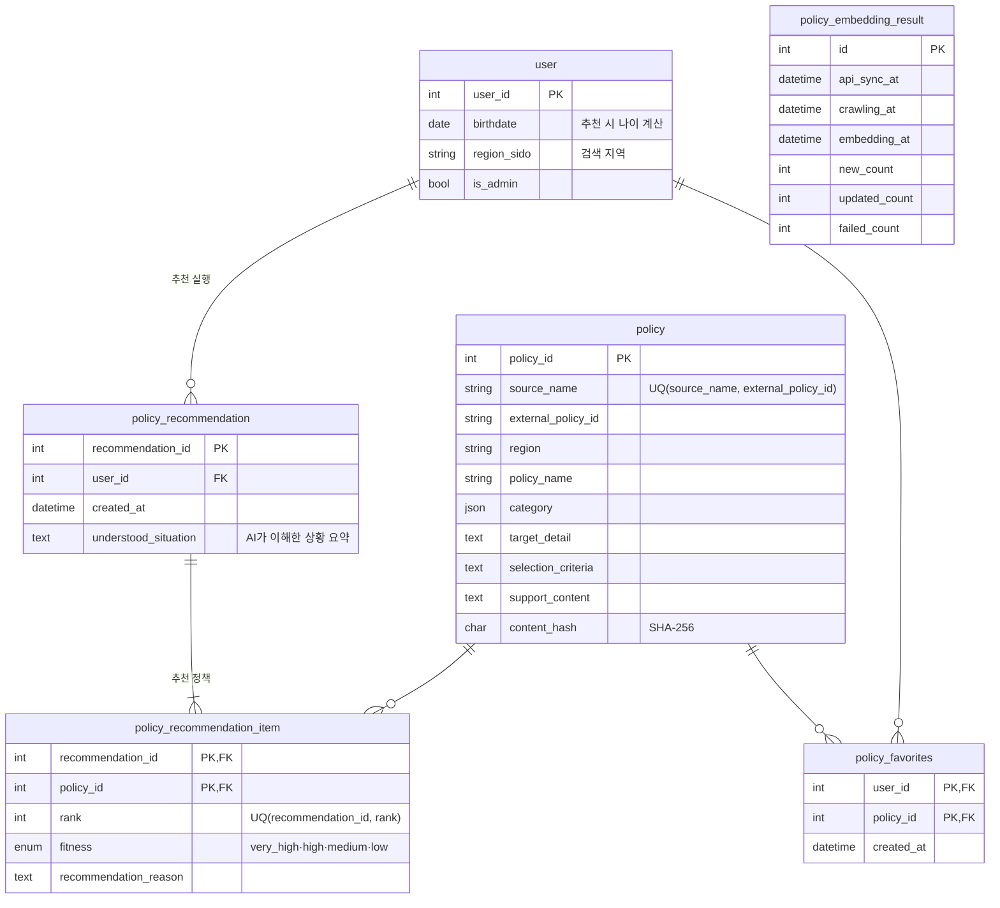

<div align="center">

# 이음 (Eum)

**가족돌봄청년의 현재 부담을 덜고 미래의 성장 기회를 이어주는 통합 지원 플랫폼**

복지정책 · 진로 · 지역 지원 정보를 AI로 연결해, 흩어진 정보를 직접 찾아다니기 어려운 가족돌봄청년의 정보 접근 문제를 다룹니다.


KDT 교육과정 중간 팀 프로젝트 · 팀 **다정다감** (3인) · 2026.07.03 ~ 2026.08.11

</div>

<!-- TODO: 서비스 메인 화면 캡처 (docs/images/main.png) -->

> **My Role** — 복지정책 추천 서비스 **'덜다'의 데이터 · AI · 백엔드 개발**
> 공공 정책 데이터 정규화·동기화 파이프라인, Content Hash 기반 증분 임베딩, MySQL FULLTEXT + Pinecone **RRF Hybrid Retrieval**, LangGraph 기반 추천 Agent와 **LLM 결과 서버 검증 로직**을 구현했습니다.
> → [My Contribution](#-my-contribution) · [Technical Challenges](#-technical-challenges--solutions)

---

## 목차

1. [프로젝트 배경](#-프로젝트-배경)
2. [서비스 구성](#-서비스-구성)
3. [System Architecture](#-system-architecture)
4. [My Contribution](#-my-contribution)
5. [덜다 End-to-End Pipeline](#-덜다-end-to-end-data--ai-pipeline)
6. [Technical Challenges & Solutions](#-technical-challenges--solutions)
7. [Database](#-database)
8. [Tech Stack](#-tech-stack)
9. [프로젝트 구조](#-프로젝트-구조)
10. [실행 방법](#-실행-방법)
11. [한계 및 개선 방향](#-한계-및-개선-방향)
12. [Team](#-team)

---

## 📌 프로젝트 배경

가족돌봄청년은 학업·취업과 가족 돌봄을 동시에 감당하면서도, 자신이 받을 수 있는 지원을 찾을 시간과 정보가 부족한 경우가 많습니다. 복지정책은 중앙부처와 지자체 포털에 나뉘어 있고, 정책마다 지원 대상과 선정 기준이 문장으로 서술되어 있어 **"내 상황에서 신청할 수 있는 정책이 무엇인지"** 를 스스로 판단하기 어렵습니다.

이음은 이 문제를 세 가지 축으로 나누어 접근합니다.

- **덜다** — 지금의 부담을 덜어줄 복지정책을 사용자 상황에 맞춰 찾아주고
- **잇다** — 돌봄 이후의 진로와 성장 기회를 이어주며
- **나누다** — 가족과 돌봄을 나누고 가까운 지역 지원기관을 연결합니다.

## 🧩 서비스 구성

| 서비스 | 설명 | 담당 |
|---|---|---|
| **덜다** (복지정책 추천) | 돌봄 상황을 입력하면 공공 정책 데이터에서 후보를 검색하고, AI Agent가 지원 대상·선정 기준을 검토해 정책을 추천. 필요한 경우 추가 질문으로 자격조건을 확인 | **주 담당** |
| 잇다 (진로 설계) | 대화형 챗봇이 강의·자격증 데이터를 기반으로 진로 방향을 추천하고 '미래설계지도'로 저장 | 팀원 담당 |
| 나누다 (돌봄 공유·지역 지원) | 돌봄 그룹·초대코드로 가족과 돌봄 기록을 공유하고, 주간 돌봄 분석과 주변 지원기관 추천을 제공 | 팀원 담당 |
| 공통 / 관리자 | 회원·인증, 공지사항, 1:1 문의, 알림, 관리자 대시보드 | 팀 공동 (관리자 대시보드 주 담당) |

<!-- TODO: 서비스별 화면 캡처 (덜다 입력 화면 / 잇다 챗봇 / 나누다 지원기관 지도) -->

## 🏗 System Architecture



- 하나의 FastAPI 앱에 서비스별 Router(`delda`, `itda`, `nanuda`, `notice`, `inquiry` …)를 등록하는 모듈형 구조입니다.
- DB 접근은 SQLAlchemy 2.0 `AsyncSession` + `aiomysql`, 인증은 JWT(`get_current_user`, `get_current_admin` Dependency)로 통일되어 있습니다.
- 세 서비스 모두 Pinecone와 Gemini를 사용하지만 인덱스와 데이터는 서비스별로 분리되어 있습니다.

---

## 🙋 My Contribution

**복지정책 추천 서비스 '덜다'의 데이터 · AI · 백엔드 개발 담당**

### 데이터 파이프라인
- 중앙부처 API(XML)·서울복지포털·경기청년포털의 서로 다른 응답을 하나의 `NormalizedPolicy` 스키마로 변환하는 **출처별 Normalizer** 구현
- `(source_name, external_policy_id)` 기준 정책 식별과 **SHA-256 Content Hash 기반 신규/변경/동일 판별** 동기화 로직 구현
- 3개 출처 수집 → 정규화 → DB 동기화 → 변경분 임베딩을 묶는 **Sync Orchestrator** 와 단계별 실행 이력(`policy_embedding_result`) 설계
- 관리자 요청 시 실행 ID를 먼저 응답하고, 실제 최신화는 FastAPI `BackgroundTasks`로 **응답 이후 백그라운드에서 실행**한 뒤 실행 ID로 진행 상태를 조회하는 API 구현
- 수집 클라이언트(중앙부처 API·서울 크롤러)는 팀원이 작성한 기반 코드를 이어받아 수정·연동했습니다.

### AI / 검색
- 정책 텍스트를 Gemini Embedding(768차원)으로 변환해 Pinecone에 upsert하는 임베딩 서비스 구현
- MySQL FULLTEXT 검색과 Pinecone 의미 검색을 병렬 실행하고 **RRF로 순위를 결합하는 Hybrid Retrieval** 구현
- LangChain `create_agent` + Tool(`search_policy_candidates`, `find_policy_by_name`) 기반 추천 Agent와 시스템 프롬프트 설계
- Agent 결과 상태에 따라 응답을 분기하는 **LangGraph Workflow** 구현
- **Agent 출력을 검색 후보·지역·연령·성별 조건으로 다시 검증하는 서버 후처리 로직** 구현
- 추가 질문(최대 2회)·반복 질문 감지·출력 재요청을 포함한 **Stateless 추가 질문 흐름** 구현

### 백엔드 / 프론트엔드
- 덜다 API: 맞춤 추천, 정책명 검색, 추천 이력, 정책 상세, 즐겨찾기, 인기 정책, 메인 데이터
- 덜다 DB 모델 설계: `policy`, `policy_recommendation`, `policy_recommendation_item`, `policy_favorites`, `policy_embedding_result`
- 관리자 대시보드 API: 기간별(7일·30일·3개월·1년) 집계, KPI, 서비스별 AI 사용량
- 문의 백엔드 일부, 공지 백엔드 일부, DB 세션 타임존(KST) 설정
- 덜다 사용자 화면(정책 찾기·추천 결과·정책 상세·덜다 메인)과 관리자 정책 최신화·대시보드 화면 구현
- 프로젝트 ERD 설계 참여

---

## 🔄 덜다 End-to-End Data & AI Pipeline



<details>
<summary><b>Hybrid RAG Architecture 상세</b></summary>



- 같은 사용자 Context에서 **의미 검색용 문장**과 **키워드 검색용 쿼리**를 따로 생성합니다.
- 두 검색은 `asyncio.gather`로 동시에 실행하고, 동기 SDK(Gemini Embedding, Pinecone query)는 `asyncio.to_thread`로 감싸 이벤트 루프를 막지 않도록 했습니다.
- 지역 조건(`전국` + 사용자 시·도)은 FULLTEXT의 `WHERE`와 Pinecone 메타데이터 필터에 **동일하게** 적용됩니다.

</details>

<details>
<summary><b>Policy Update / Incremental Embedding Pipeline 상세</b></summary>



- 진행 상태를 별도 컬럼으로 두지 않고, **단계별 완료 시각 중 어디까지 채워졌는지**로 계산합니다 (`completed_with_failures` 포함).

</details>

### LangGraph Recommendation Workflow



- Agent의 구조화 출력(`PolicyAgentOutput`)의 `status` 값으로 6개 응답 노드 중 하나로 분기합니다.
- 모든 노드는 한 번의 요청에서 `END`로 끝나며, 추가 질문은 **다음 HTTP 요청**으로 이어집니다 (아래 Challenge 5).

<!-- TODO: 덜다 입력 화면 / 추천 결과 / 추가 질문 화면 / 정책 상세 캡처 -->

---

## 🔧 Technical Challenges & Solutions

### 1. Keyword Search와 Semantic Search의 결합 → RRF Hybrid Retrieval

**문제**
사용자 입력은 "부모님을 1~3년간 하루 4~8시간 돌봄, 생활비·의료비 필요" 같은 **선택값의 조합**인 반면, 정책 문서는 "기준 중위소득", "가족돌봄청년" 같은 **행정 용어와 자격 문장**으로 쓰여 있습니다. 키워드 검색만으로는 표현이 다른 정책을 놓치고, 벡터 검색만으로는 정책명·명시된 조건처럼 정확히 일치해야 하는 단어에 약합니다.

**원인 / 고민**
두 검색을 함께 쓰려면 결과를 합쳐야 하는데, MySQL FULLTEXT relevance 점수와 벡터 유사도는 **척도가 다릅니다**. 점수를 정규화해 가중합하면 가중치를 정해야 하고, 이를 판단할 평가 데이터가 없는 상태에서 임의로 정하는 것은 근거가 약하다고 판단했습니다.

**해결**
- 점수 대신 **각 검색의 순위만 사용하는 RRF(Reciprocal Rank Fusion)** 로 결합했습니다.

  ```python
  # policy_retrieval_service.py
  RRF_K = 60
  for rank, policy_id in enumerate(fulltext_ids, start=1):
      scores[policy_id] = scores.get(policy_id, 0) + 1 / (RRF_K + rank)
  for rank, policy_id in enumerate(vector_ids, start=1):
      scores[policy_id] = scores.get(policy_id, 0) + 1 / (RRF_K + rank)
  ```
- 같은 Context에서 의미 검색용 자연어 문장과 FULLTEXT용 키워드 쿼리를 **각각 생성**해 검색 특성에 맞는 입력을 넣었습니다.
- 두 검색은 `asyncio.gather`로 병렬 실행하고, 동기 SDK 호출은 `asyncio.to_thread`로 분리했습니다.

**결과**
- 점수 정규화나 가중치 튜닝 없이 서로 다른 검색 결과를 하나의 후보 목록으로 결합할 수 있게 되었습니다.
- 두 검색에서 모두 상위에 오른 정책이 우선되면서도, 한쪽 검색에만 걸린 정책도 후보에 남습니다.
- 두 검색이 순차 대기하지 않고 동시에 진행됩니다.

### 2. 매번 전체를 다시 임베딩하는 비효율 → Content Hash 기반 Incremental Embedding

**문제**
정책 데이터는 3개 출처에서 주기적으로 다시 수집해야 합니다. 수집할 때마다 전체 정책을 임베딩하면 대부분 바뀌지 않은 정책에도 임베딩 API 호출과 Pinecone 쓰기가 반복됩니다.

**원인 / 고민**
출처마다 응답 형식이 달라 "내용이 바뀌었는지"를 판단할 공통 기준이 필요했습니다. 또한 공백 차이나 카테고리 순서 차이처럼 **의미 없는 차이 때문에 변경으로 판단되면** 증분 처리의 의미가 줄어듭니다.

**해결**
- `(source_name, external_policy_id)` UNIQUE 제약으로 출처별 동일 정책을 식별합니다.
- 정규화된 정책 내용으로 **SHA-256 해시**를 만들되, 실행 시각은 제외하고 문자열 공백을 정규화하며 카테고리는 **중복 제거 후 정렬**해 순서 차이를 없앴습니다.
- 동기화 결과를 `CREATED` / `UPDATED` / `SKIPPED`로 구분하고, **신규·변경된 `policy_id`만** 임베딩 대상으로 넘깁니다.
- Pinecone 벡터 ID를 `policy-{policy_id}`로 고정해 변경 시 같은 벡터를 덮어쓰도록 했습니다.
- 임베딩은 요청 간격을 두고 실행하며, 실패한 정책만 모아 한 번 더 재시도한 뒤 최종 실패 ID와 건수를 실행 이력에 남깁니다.

**결과**
- 재수집 시 내용이 바뀌지 않은 정책은 DB 업데이트와 임베딩을 모두 건너뜁니다.
- 관리자는 실행 이력에서 신규·변경·실패 건수와 단계별 진행 상태를 확인할 수 있습니다.

### 3. LLM 추천 결과를 그대로 신뢰할 수 없는 문제 → Backend Validation

**문제**
Agent가 최종 정책을 고르더라도, LLM 출력에는 검색되지 않은 정책 ID, 중복 정책, 사용자 지역에서 신청할 수 없는 정책 등이 섞일 수 있습니다. 복지정책은 잘못 추천하면 사용자가 신청 불가능한 정책에 시간을 쓰게 되므로 이 부분이 중요했습니다.

**원인 / 고민**
프롬프트로 "후보에 없는 정책을 만들지 말라"고 지시하는 것만으로는 출력이 지켜진다고 보장할 수 없습니다. 반면 지역·연령처럼 **코드로 확인할 수 있는 조건**은 LLM 판단에 맡길 필요가 없다고 보았습니다.

**해결**
- Tool이 실제로 검색한 정책을 요청 단위 `candidate_store`에 보관하고, Agent는 `policy_id`만 반환하게 했습니다.
- Agent 출력을 서버에서 다음 순서로 다시 검증합니다.

  | 검증 | 처리 |
  |---|---|
  | 검색 후보(`candidate_store`)에 없는 정책 | 제외 |
  | 같은 정책 중복 | 제외 |
  | 정책 지역 ≠ 사용자 지역 (전국 정책은 허용) | 제외 |
  | 정책에 명시된 연령 범위 밖 | 제외 |
  | 특정 성별 전용 정책 (맞춤 추천에는 성별 정보가 없음) | 제외 |
  | 사용자가 요청하지 않은 정신건강 전용 정책 | 제외 |
  | 자격 판단과 적합도 불일치 | 보정 (`eligible`→high 이상, `needs_confirmation`→medium, `ineligible`→low) |
  | 적합도 `low` | 제외 |

- 검증을 통과한 정책만 최대 5개까지 반환하며, 남는 정책이 없으면 `no_policy_found`로 전환합니다.

**결과**
- LLM 출력의 신뢰성을 높이기 위해 **검색 후보와 도메인 조건을 기준으로 최종 결과를 서버에서 검증**하는 구조를 만들었습니다.
- LLM은 문장으로 쓰인 자격조건 해석을 맡고, 코드로 판정 가능한 조건은 서버가 확정하는 방식으로 역할을 나눴습니다.

### 4. 서로 다른 공공정책 데이터 구조 → Normalized Data Pipeline

**문제**
세 출처는 데이터 형태가 모두 다릅니다.

| 출처 | 형태 | 처리해야 할 점 |
|---|---|---|
| 중앙부처 복지서비스 API | XML, 목록·상세 API 분리 | 전체 건수 기준 페이지네이션, 콤마 구분 값 분리, 신청 방법·안내 PDF 추출 |
| 서울복지포털 | HTML | 생애주기·가구 특성·서비스 유형이 **비트값**으로 인코딩, JavaScript 링크 인자에서 ID 추출 |
| 경기청년포털 | HTML, 카테고리별 목록 | 마지막 offset 파싱 후 페이지 순회, **여러 카테고리에 중복 게시된 정책 제거** |

**해결**
- 출처별 Normalizer가 각 형식을 공통 스키마 `NormalizedPolicy`(Pydantic)로 변환합니다. 지역, 정책명, 기관, 카테고리, 지원 대상, 선정 기준, 지원 내용, 신청 방법 등이 공통 필드입니다.
- 서울 포털은 비트값을 카테고리 목록으로 디코딩하고, 경기 포털은 게시물 번호 기준으로 카테고리 간 중복을 제거했습니다.
- 정규화 이후의 DB 동기화, 해시 비교, 임베딩, 검색은 **출처와 무관하게 같은 코드**를 사용합니다.
- 수집 요청에는 요청 간격과 재시도 대상 HTTP 상태 코드 기반 재시도를 적용했습니다. (수집 클라이언트 기반 코드는 팀원 작성, 정규화·동기화 이후 단계는 주 담당으로 구현)

**결과**
- 새 출처를 추가할 때 수집기와 Normalizer만 작성하면, 이후 파이프라인을 그대로 재사용할 수 있는 구조입니다.

<details>
<summary><b>5. Stateless 환경에서 추가 질문 Context 유지</b></summary>

**문제**
정책 자격조건 중에는 폼 입력만으로 확인할 수 없는 항목(예: 소득 기준 충족 여부)이 있어 사용자에게 추가로 물어봐야 합니다. 한 요청 안에서 Agent가 질문을 반복하면 요청이 끝나지 않고, 대화 상태를 서버 세션에 저장하면 관리할 상태가 늘어납니다.

**해결**
- LangGraph는 `need_more_information` 상태에서 **질문을 반환하고 종료**합니다. 프론트엔드는 질문·답변 쌍(`policy_id`, `condition_key`, `question`, `answer`)을 다음 요청의 `follow_up_answers`에 담아 다시 보냅니다. 추가 질문 답변은 DB에 저장하지 않습니다.
- 요청마다 Agent와 `candidate_store`가 새로 생성되므로, **이전에 질문했던 정책 중 이번 출력이 참조한 정책만** DB에서 다시 불러와 후보를 복원한 뒤 검증합니다.
- 출력 보정 규칙:
  - 추가 질문은 **최대 2회**까지만 허용합니다. 상한 이후에도 질문을 반환하면 1회 재요청하고, 그래도 질문하면 `no_policy_found`로 정리합니다.
  - `need_more_information`인데 질문이 비어 있으면 1회 재요청합니다.
  - 같은 `policy_id` + `condition_key`를 다시 묻는 **반복 질문을 감지**하면 재요청하고, 재요청 후에도 반복하면 확인 불가로 종료합니다.
  - Agent 실행에는 `recursion_limit`를 두어 Tool 호출 반복을 제한합니다.

**결과**
- 서버 세션 없이도 여러 턴에 걸친 자격 확인이 가능하고, 질문 횟수와 종료 조건이 코드로 보장됩니다.

</details>

---

## 🗄 Database

덜다 핵심 테이블 (SQLAlchemy 모델 기준)



| 설계 포인트 | 내용 |
|---|---|
| 출처별 정책 식별 | `UNIQUE(source_name, external_policy_id)` — 출처가 달라도 ID 충돌 없이 동기화 |
| 추천 결과 무결성 | item은 `(recommendation_id, policy_id)` 복합 PK + `UNIQUE(recommendation_id, rank)`로 같은 추천 내 정책·순위 중복 방지 |
| 즐겨찾기 중복 방지 | `(user_id, policy_id)` 복합 PK |
| 입력 원문 미저장 | 폼 입력값·추가 질문 답변은 저장하지 않고, AI가 이해한 상황 요약과 추천 결과만 저장 |
| 실행 이력 | 최신화 1회당 1행을 단계별로 갱신, 상태는 타임스탬프로 계산 |

<!-- TODO: 전체 서비스 ERD 이미지 (docs/images/erd.png) -->

---

## 🛠 Tech Stack

### Backend
| 기술 | 사용 위치 |
|---|---|
| `FastAPI` | 서비스별 Router 구성, `Depends` 기반 DB 세션·인증 주입, `BackgroundTasks`로 정책 최신화를 응답 이후 백그라운드에서 실행 (별도 Task Queue는 사용하지 않음) |
| `SQLAlchemy 2.0 (async)` + `aiomysql` | `AsyncSession` 기반 DB 접근, 모델 기반 테이블 생성 |
| `Pydantic` | 요청 검증(`extra="forbid"`, 길이 제한), `NormalizedPolicy` 공통 스키마, Agent 구조화 출력 스키마 |
| `httpx` | 공공 API·포털 비동기 요청, 타임아웃·재시도 |
| `BeautifulSoup4` | 서울·경기 포털 HTML 파싱 |
| `PyJWT`, `bcrypt` | 로그인 토큰 발급·검증, 비밀번호 해싱 |

### AI / Data
| 기술 | 사용 위치 |
|---|---|
| `LangChain` | `create_agent`, `@tool`로 검색 Tool 정의, `response_format`으로 구조화 출력 |
| `LangGraph` | 추천 Agent 결과 상태별 응답 분기 Workflow |
| `Gemini` | 추천 Agent LLM(`gemini-2.5-flash`), 정책 임베딩(`gemini-embedding-2`, 768차원) |
| `Pinecone` | 정책 벡터 저장·지역 메타데이터 필터 검색 (cosine) |
| `MySQL FULLTEXT` | 키워드 기반 정책 검색 (NATURAL LANGUAGE MODE) |

### Frontend
| 기술 | 사용 위치 |
|---|---|
| `React 18`, `React Router 6` | 사용자·관리자 화면 라우팅 |
| `Vite` | 개발 서버, `/api` → 백엔드 프록시 |

### Infra / Collaboration
| 기술 | 사용 위치 |
|---|---|
| `systemd` + `uvicorn` | 백엔드 서비스 실행 설정 (`Backend/deploy/eum-backend.service`) |
| `Git` / `GitHub` | 서비스별 feature 브랜치 작업 후 main 병합 |

---

## 📁 프로젝트 구조

<details>
<summary>주요 디렉터리 구조 펼치기</summary>

```text
E-eum/
├── Backend/
│   ├── app/
│   │   ├── main.py                 # FastAPI 앱, Router 등록, lifespan(DB 초기화)
│   │   ├── database.py             # Async Engine · Session · Base
│   │   ├── delda/                  # 덜다 — 복지정책 추천 (주 담당)
│   │   │   ├── clients/            #   중앙부처 API · 서울 · 경기 수집 클라이언트
│   │   │   ├── normalizers/        #   출처별 응답 → NormalizedPolicy 변환
│   │   │   ├── services/           #   동기화 · 오케스트레이터 · 임베딩 · Hybrid 검색 · Agent · 프롬프트
│   │   │   ├── graphs/             #   LangGraph 추천 Workflow
│   │   │   ├── scripts/            #   Pinecone 인덱스 생성 · 전체 동기화 · 전체 임베딩 CLI
│   │   │   ├── models.py           #   덜다 DB 모델
│   │   │   ├── schemas.py          #   요청·응답 · NormalizedPolicy 스키마
│   │   │   ├── router.py           #   사용자 / 관리자 Router
│   │   │   └── controllers.py
│   │   ├── itda/                   # 잇다 — 진로 설계 챗봇
│   │   ├── nanuda/                 # 나누다 — 돌봄 공유 · 주간 분석 · 지원기관
│   │   ├── user/                   # 회원 · JWT 인증
│   │   ├── dashboard/              # 관리자 대시보드 (주 담당)
│   │   ├── notice/ · inquiry/      # 공지 · 문의
│   │   └── notifications/ · mypage/
│   ├── deploy/                     # systemd 서비스 유닛
│   └── requirements.txt
└── frontend/
    └── src/
        ├── api/                    # 백엔드 호출 (welfare.js = 덜다)
        ├── pages/
        │   ├── welfare/            # 덜다 화면 (주 담당)
        │   ├── learn/ · family/ · share/
        │   └── admin/              # 관리자 (AdminWelfare · Dashboard 주 담당)
        ├── components/ · store/
        └── App.jsx
```

</details>

---

## ▶ 실행 방법

<details>
<summary>환경 변수 · Backend · 덜다 데이터 준비 · Frontend 실행 순서 펼치기</summary>

### 1. 환경 변수

`Backend/app/.env.exmple`을 참고해 `Backend/app/.env`를 작성합니다. 실제 키 값은 저장소에 포함하지 않습니다.

**필요한 환경 변수**

| 구분 | 변수 |
|---|---|
| DB | `DB_HOST`, `DB_PORT`, `DB_NAME`, `DB_USER`, `DB_PASSWORD` |
| 인증 | `JWT_SECRET_KEY` (비어 있으면 서버 기동 시 오류) |
| 덜다 | `WELFARE_API_KEY`, `GEMINI_API_KEY`, `PINECONE_API_KEY`, `PINECONE_POLICY_INDEX_NAME`, `POLICY_EMBEDDING_DIMENSION` |
| 잇다 · 나누다 | `DATA_GO_KR_KEY`, `JINA_API_KEY`, `KAKAO_REST_API_KEY`, `PUBLIC_DATA_API_KEY`, `PINECONE_COURSE_INDEX_NAME`, `PINECONE_INSTITUTION_INDEX_NAME` 등 |

모든 서비스 Router가 하나의 앱에 등록되어 있어, 서버 전체를 기동하려면 잇다·나누다 항목도 필요합니다.


### 2. Backend

```bash
cd Backend
python -m venv .venv
source .venv/bin/activate          # Windows: .venv\Scripts\activate
pip install -r requirements.txt

# 서버 실행 (기동 시 모델 기준으로 누락 테이블 생성)
python -m uvicorn app.main:app --reload --port 8000
```

### 3. 덜다 데이터 준비

```bash
cd Backend
python -m app.delda.scripts.init_pinecone_index    # Pinecone 정책 인덱스 생성
python -m app.delda.scripts.sync_all_policies      # 3개 출처 수집 → 동기화 → 변경분 임베딩
```

정책 최신화는 관리자 화면에서도 실행할 수 있습니다 (`POST /admin/policy-sync`).

> MySQL FULLTEXT 검색을 위해 `policy` 테이블의 검색 대상 컬럼에 FULLTEXT INDEX가 필요합니다. 현재 해당 DDL은 저장소에 포함되어 있지 않습니다.

### 4. Frontend

```bash
cd frontend
npm install
npm run dev        # http://localhost:5173, /api 요청은 127.0.0.1:8000으로 프록시
```

</details>

---

## 🧭 한계 및 개선 방향

현재 구현 범위와 다음 단계로 고려하고 있는 개선 사항입니다.

| 현재 구현 범위 | 개선 방향 |
|---|---|
| 정책 최신화는 관리자 요청 시 FastAPI `BackgroundTasks`로 응답 이후 같은 서버 프로세스에서 실행되며, 실행 중 재요청을 막는 장치는 없습니다. | 진행 중인 실행 이력이 있으면 새 실행을 거부하는 잠금 또는 상태 검사 추가, 작업 큐 도입 검토 |
| 동기화는 신규·변경 정책을 반영하며, 출처에서 삭제된 정책은 DB와 Pinecone에 남습니다. | 수집 시점에 보이지 않은 정책을 비활성화하고 벡터도 함께 정리하는 처리 추가 |
| 덜다는 검색·추천 품질을 측정하는 평가 데이터셋이 없어 정량 지표를 제시하지 않았습니다. | 대표 돌봄 상황별 기대 정책을 정리한 평가셋을 만들고, RRF 결합 전후 Recall@K와 추천 적합도 측정 |
| FULLTEXT 인덱스는 모델에 정의되어 있지 않아 DB에서 별도로 생성해야 합니다. | 인덱스를 마이그레이션 또는 초기화 스크립트로 관리 |
| 성별 조건 정책은 사용자 성별 정보가 없어 맞춤 추천에서 제외됩니다. | 필요 시 추가 질문으로 확인하는 흐름으로 확장 |

---

## 👥 Team

**팀 다정다감** · KDT 교육과정 중간 팀 프로젝트 (3인)

| 담당 | 역할 |
|---|---|
| [@SY9507](https://github.com/SY9507) | **덜다** 데이터 파이프라인 · Hybrid RAG · 추천 Agent · API · 화면, 관리자 대시보드, 공지·문의 백엔드 일부 |
| [@regionse](https://github.com/regionse) | **잇다** 진로 설계 챗봇, 공지·문의·인증, 배포 설정 |
| [@Kweonyh0](https://github.com/Kweonyh0) | **나누다** 돌봄 공유 · 주간 돌봄 분석 · 지원기관 추천, 알림 · 마이페이지 |

<!--
TODO: 화면 캡처 추가 위치
- 상단: 서비스 메인
- 덜다 Pipeline 섹션 아래: 덜다 입력 화면 / 추천 결과 / 추가 질문 / 정책 상세
- Incremental Embedding 섹션: 관리자 정책 관리 · 데이터 최신화 진행 화면
- Database 섹션: 전체 ERD 이미지
-->
